# Setup guide — personal / single-account scope

This walks through standing up **one** ephemeral Spot runner fleet, backed by one custom AMI, scoped to your own GitHub account or a single org. It's the "works for me" path. If you're rolling this out for an organization with multiple teams, read this first, then see [org rollout notes](03-org-rollout.md) for what changes.

Background on *why* each piece exists is in [concepts](01-concepts.md) — this doc is the "what to actually run."

## Contents

1. [Prerequisites](#prerequisites)
2. [Step 1: Create a GitHub App](#step-1--create-a-github-app)
3. [Step 2: Store the credentials in Secrets Manager](#step-2--store-the-github-app-credentials-in-aws-secrets-manager)
4. [Step 3: Build the custom AMI](#step-3--build-the-custom-ami)
5. [Step 4: Deploy the Terraform module](#step-4--deploy-the-terraform-module)
6. [Step 5: Point the GitHub App at the webhook](#step-5--point-the-github-app-at-the-deployed-webhook)
7. [Step 6: Use it in workflows](#step-6--use-it-in-workflows)

The order matters: the secret (step 2) and the AMI (step 3) must exist before `terraform plan` in step 4, because the module reads the secret and looks up the AMI at plan time.

## Prerequisites

| Tool | Purpose | Version used as reference |
|---|---|---|
| Terraform | Provision runner infra, IAM | >= 1.13.x (latest stable: 1.16.x) |
| Packer | Build the custom runner AMI | latest 1.x |
| AWS CLI | Auth, secrets, general AWS ops | v2 |
| GitHub admin access | Create the GitHub App (org admin, or repo admin for a personal-account/single-repo setup) | — |
| An AWS account with a VPC already provisioned | Runners launch into existing subnets | — |

You'll need permission to create IAM roles, EC2 instances/AMIs, Lambda functions, API Gateway, Secrets Manager secrets, and CloudWatch log groups.

The Terraform in [`terraform/`](../terraform) is parameterized with variables — no placeholder find-and-replace needed. You'll fill in real values in `terraform.tfvars` in Step 4.

## Step 1 — Create a GitHub App

Self-hosted runners need an identity to register themselves with GitHub. A GitHub App (not a PAT) is the standard mechanism because it can be scoped tightly and rotated without touching a human account.

1. GitHub → **Settings → Developer settings → GitHub Apps → New GitHub App** (org-level: **Organization Settings → Developer settings**; personal-account/single-repo: your personal **Settings**). **Where you create it decides where it can be installed** — a personal-account app can only be installed on repos you own; an org app can only be installed within that org. For this guide (personal/single-account scope), create it under your personal Settings.
    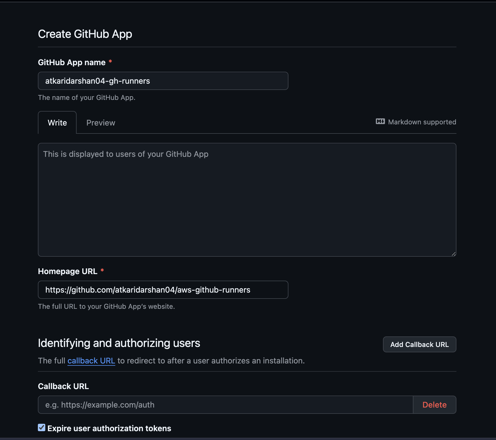

2. **Homepage URL**: the repo or org this app belongs to, e.g. `https://github.com/octo-org/aws-github-runners`. Just needs to be a valid URL — not used functionally by runner registration.
3. **Webhook URL**: leave any placeholder for now (e.g. `https://example.com`) — you don't have the real API Gateway endpoint until after Step 4, and you'll update it in Step 5.
4. Repository permissions:

    | Permission | Access |
    |---|---|
    | Actions | Read-only |
    | Checks | Read-only |
    | Administration | Read & write |
    | Metadata | Read-only |

    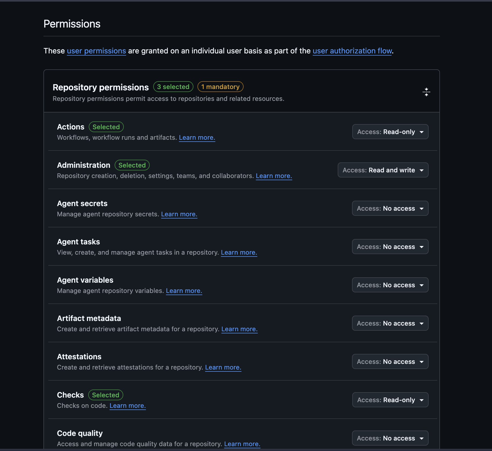

5. Organization permissions (org-scoped installs only):

    | Permission | Access |
    |---|---|
    | Self-hosted runners | Read & write |

6. Subscribe to the **Workflow job** webhook event.

    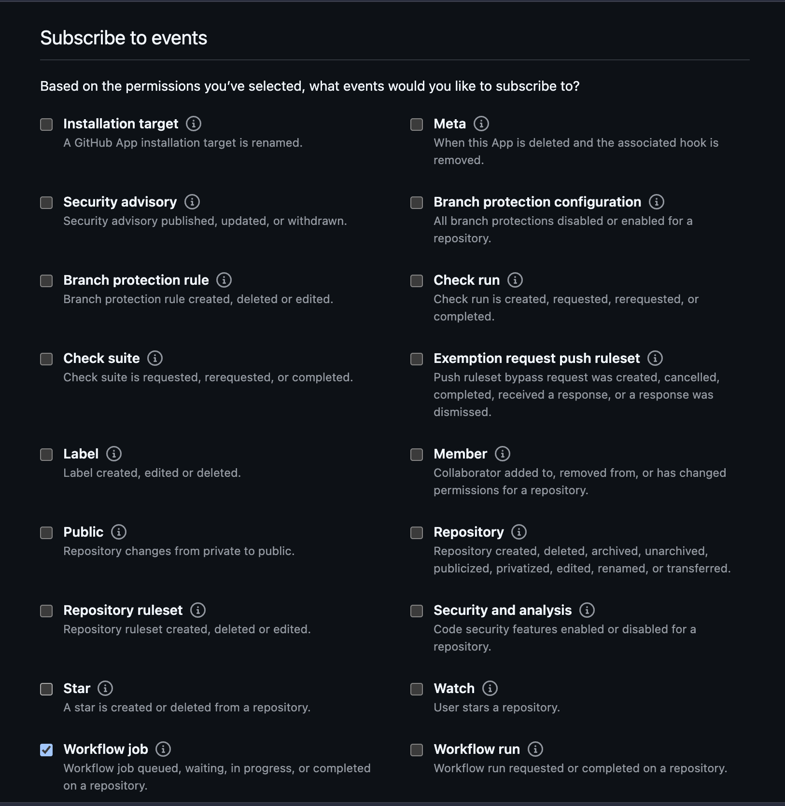

7. Generate a private key (downloads a `.pem`), note the **App ID**, and set a **Webhook secret**. Then choose installation scope and create the app:

    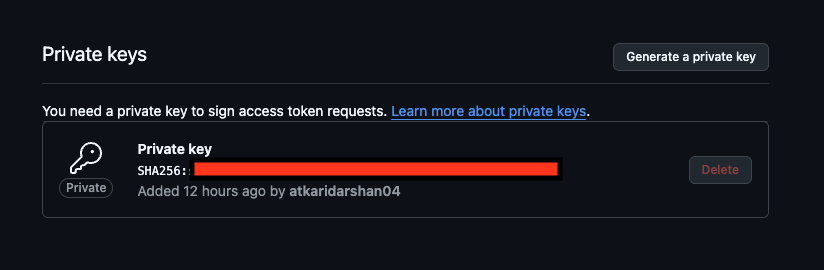
    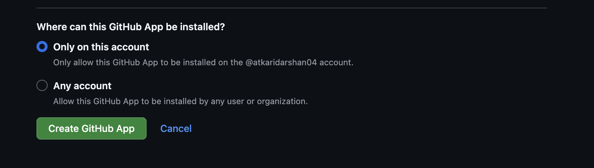

8. Install the app (button on the app's page) — choose **Only select repositories** and pick the repo(s) you're testing with, rather than **All repositories**, so this stays scoped while you're getting it working. Installation scope and `enable_organization_runners` (Step 4) are independent settings that both have to allow a repo through — see [org rollout](03-org-rollout.md) once this works end to end and you're ready to open it up.

    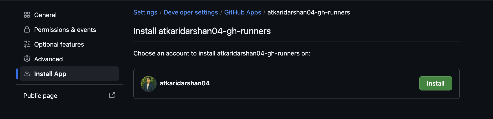
    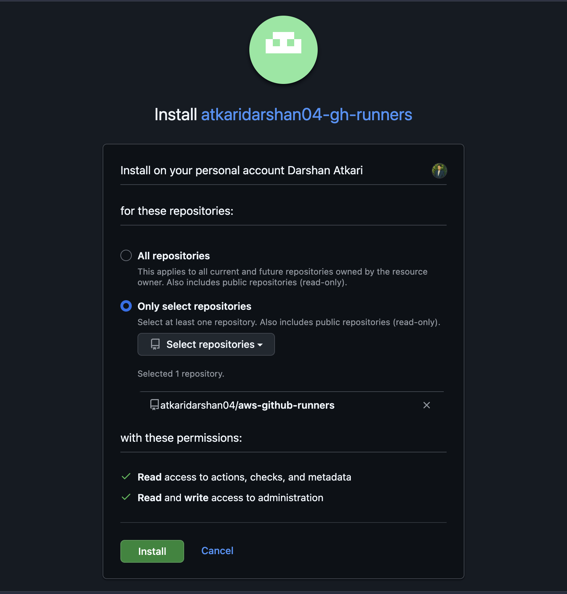
    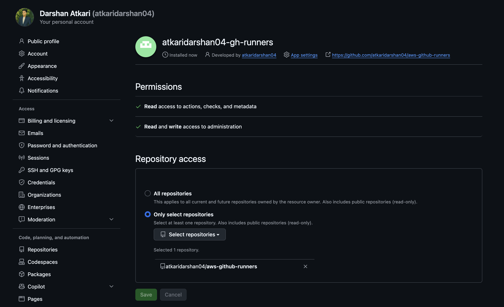

**Verify:** the app's settings page shows an App ID, a generated private key, and the installation lists the repos you chose.

## Step 2 — Store the GitHub App credentials in AWS Secrets Manager

Base64-encode the private key:

```bash
cat your-app-private-key.pem | base64 -w 0
```

Create a secret (name it something like `<PROJECT_NAME>-github-app-secrets`) with this shape:

```json
{
  "github_app_id": "123456",
  "github_app_key_base64": "<base64-encoded-private-key>",
  "github_app_webhook_secret": "your-webhook-secret"
}
```

```bash
aws secretsmanager create-secret \
  --name "<PROJECT_NAME>-github-app-secrets" \
  --secret-string file://github-app-secrets.json \
  --region <REGION>
```

Never commit the raw JSON or `.pem` — only reference the secret name from Terraform.

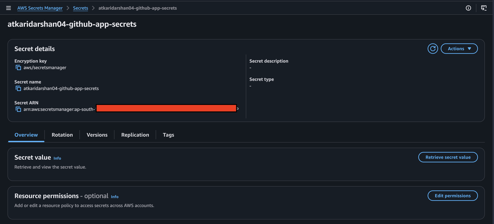

**Verify:**

```bash
aws secretsmanager describe-secret --secret-id "<PROJECT_NAME>-github-app-secrets" --region <REGION> --query Name
```

## Step 3 — Build the custom AMI

Do this before deploying the Terraform module — the module's `ami` filter needs a matching AMI to already exist.

### What goes into it

At minimum, mirror what the reference AMI carries:

- Ubuntu 22.04 LTS (or your preferred base)
- Docker (for containerized builds)
- The GitHub Actions Runner binary
- AWS CLI v2
- Common tools: `git`, `curl`, `jq`, `unzip`

Add anything your pipelines actually need pre-installed (language runtimes, `uv`/`poetry`, `kubectl`, `helm`, `terraform`, scanners, etc.) — every tool baked into the AMI is one less install per job.

### Build it

The `terraform-aws-github-runner` project ships a ready-made Packer template — don't write one from scratch unless you need to diverge significantly.

```bash
git clone https://github.com/github-aws-runners/terraform-aws-github-runner
cd terraform-aws-github-runner/images/ubuntu-jammy
```

If you need extra tools baked in, edit the provisioning steps in this directory's `.pkr.hcl` / associated scripts before building (or fork it and add your own provisioner block).

```bash
packer init github_agent.ubuntu.pkr.hcl
packer build -var "region=<REGION>" github_agent.ubuntu.pkr.hcl
```

What happens under the hood:

1. Packer launches a temporary EC2 instance from a base Ubuntu AMI in `<REGION>`
2. It runs the provisioning scripts (Docker, runner binary, AWS CLI, your extra tools)
3. It stops the instance and snapshots it as a new AMI
4. It terminates the temporary instance
5. The resulting AMI appears in your account, named `github-runner-ubuntu-jammy-amd64-<timestamp>` — that's a **hardcoded value in the template** (`ami_name` in the `source` block), not something you pass in with `-var`. `terraform/main.tf`'s AMI filter is written to match this exact name, so the stock template works with no changes.

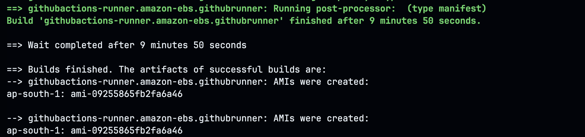
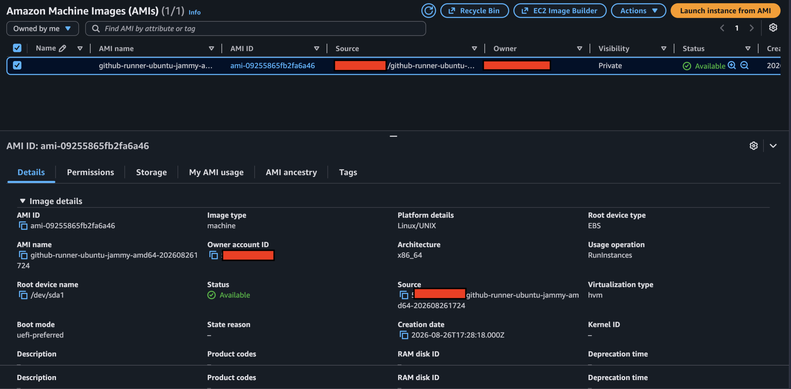

Requirements to run this:

- AWS credentials with EC2 (`RunInstances`, `CreateImage`, `TerminateInstances`, snapshot permissions) in the target account
- Outbound internet from wherever Packer runs (to fetch the base AMI's packages)

If this AWS account will ever build AMIs for more than one project, the shared `github-runner-*` name will collide across them — fork the `.pkr.hcl` to prefix `ami_name` with something project-specific, and update `terraform/main.tf`'s `ami.filter.name` to match. Not needed for this single-project guide.

**Verify:**

```bash
aws ec2 describe-images --owners self --region <REGION> \
  --filters "Name=name,Values=github-runner-ubuntu-jammy-amd64-*" \
  --query 'Images[].[Name,ImageId]' --output table
```

## Step 4 — Deploy the Terraform module

Don't hand-roll the webhook/scaling logic — the [`terraform/`](../terraform) directory in this repo wraps the community-maintained [`github-aws-runners/terraform-aws-github-runner`](https://github.com/github-aws-runners/terraform-aws-github-runner) module (pinned to `7.11.0`) and is ready to run as-is:

| File | What's in it |
|---|---|
| [`terraform/versions.tf`](../terraform/versions.tf) | Terraform/provider version constraints |
| [`terraform/variables.tf`](../terraform/variables.tf) | Every input you can tune — region, account, VPC, instance types, fleet size, etc. |
| [`terraform/main.tf`](../terraform/main.tf) | The security group, the Secrets Manager lookup, and the `github_runner` module block itself |
| [`terraform/outputs.tf`](../terraform/outputs.tf) | Webhook URL, runner IAM role ARN, and other values you need after `apply` |
| [`terraform/terraform.tfvars.example`](../terraform/terraform.tfvars.example) | Template for your own `terraform.tfvars` (gitignored) |

### Configure and deploy

```bash
cd terraform
cp terraform.tfvars.example terraform.tfvars
# edit terraform.tfvars: aws_region, aws_account_id, project_name, vpc_id, subnet_ids

../scripts/download-lambda-packages.sh
```

The script reads the module version pinned in `main.tf`, so the zips always match it.

> **Why a separate download step**: the module's Lambda code is distributed as versioned zip releases, not vendored into the module itself — `main.tf` references them from `terraform/lambda-packages/`, which is gitignored (build artifacts, not source). After bumping the module version in `main.tf`, re-run the script.

Optional inputs in `terraform.tfvars`:

| Variable | Default | Purpose |
|---|---|---|
| `runner_extra_labels` | `["aws-spot"]` | Labels the runners register with. Add one to `runs-on` to target this fleet (`runs-on: [self-hosted, linux, x64, aws-spot]`). A job listing only `self-hosted, linux, x64` can still land here. |
| `create_service_linked_role_spot` | `true` | Lets the scale-up Lambda create the `AWSServiceRoleForEC2Spot` role on the first Spot launch. Only needed until the role exists; setting `false` afterwards just removes that permission. |
| `runners_maximum_count` | `8` | Cap on concurrent runners, see [operations](05-operations.md#capacity-and-limits). |

```bash
terraform init
terraform plan
terraform apply
```

`project_name` drives the `-github-app-secrets` Secrets Manager lookup — make sure it matches what you used in Step 2. The AMI filter (Step 3) matches on the Packer template's own naming, not `project_name`.

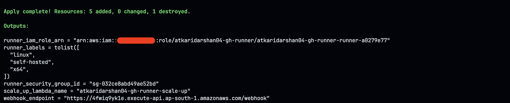
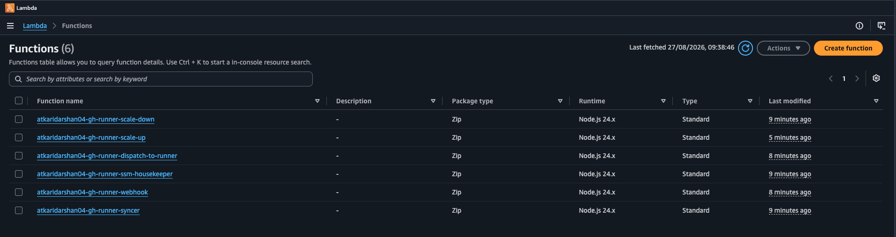

If the first job fails to launch with a service-linked-role error in the scale-up Lambda's log, create the Spot role once:

```bash
aws iam create-service-linked-role --aws-service-name spot.amazonaws.com
```

**Verify:** `terraform output` prints the webhook endpoint, and the module's Lambda functions exist in the console.

## Step 5 — Point the GitHub App at the deployed webhook

```bash
terraform output -raw webhook_endpoint
```

Set the printed URL as the GitHub App's webhook URL (App settings → **Webhook → Payload URL**).

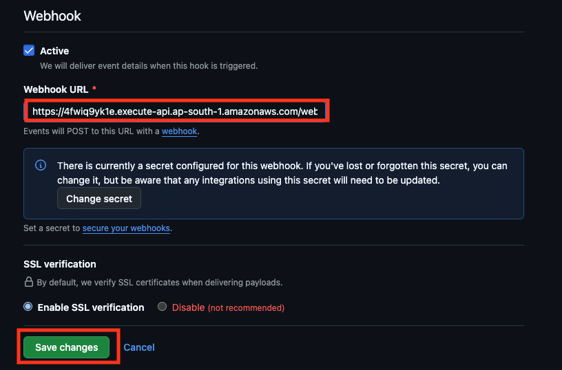

**Verify:** in the app's settings, **Advanced → Recent deliveries** shows deliveries with a `200` response once a workflow job is queued.

## Step 6 — Use it in workflows

A job routes to this fleet when its `runs-on` includes the fleet's labels: `self-hosted`, the OS and architecture labels, and the custom label from `runner_extra_labels` (`aws-spot` by default).

```yaml
name: ci

on:
  pull_request:
  push:
    branches: [main]

jobs:
  build-and-test:
    runs-on: [self-hosted, linux, x64, aws-spot]
    steps:
      - uses: actions/checkout@v7

      # Proves this is actually your fleet, and a fresh instance per job —
      # a persistent/reused runner would show the same instance ID across runs.
      - name: Identify the runner instance
        run: |
          TOKEN=$(curl -fs -X PUT "http://169.254.169.254/latest/api/token" \
            -H "X-aws-ec2-metadata-token-ttl-seconds: 60")
          curl -fs -H "X-aws-ec2-metadata-token: $TOKEN" \
            http://169.254.169.254/latest/meta-data/instance-id

      # Proves ephemeral behavior: a leftover marker from a prior job means
      # this instance was reused instead of freshly launched.
      - name: Confirm no state left over from a previous job
        run: |
          test ! -f /tmp/ci-marker && echo "clean instance, no prior job state"
          touch /tmp/ci-marker

      # Self-contained smoke test — proves Docker itself works from the AMI
      - name: Docker smoke test
        run: docker run --rm hello-world
```

Two things worth checking the first time you run this: the instance ID printed should be different on every run (confirms ephemeral, not reused), and the smoke test should start immediately without any `apt install`/image-layer-download output beyond pulling `hello-world` itself (confirms Docker and the runner binary came from the AMI, not a fresh install). If you see package-manager output on a "normal" run, something's pulling from outside the AMI and it's worth finding out what.

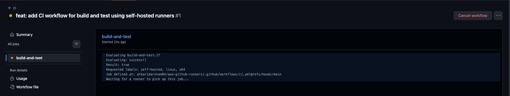
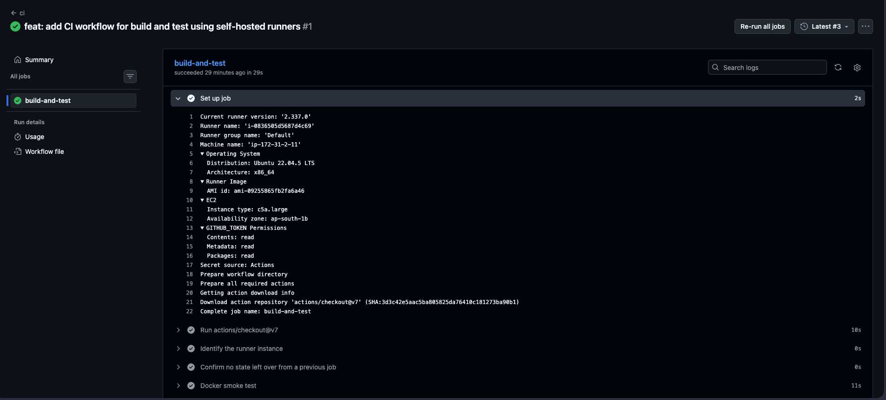

The EC2 console confirms the same thing from the infrastructure side — an instance launches for the job, then terminates right after:

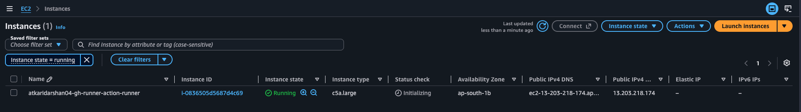
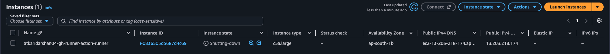

### Verify the infrastructure actually did something

Once the workflow run finishes, check CloudWatch Logs — the module creates these automatically (see [operations](05-operations.md)), no manual setup needed:

```bash
aws logs describe-log-groups \
  --log-group-name-prefix "/aws/lambda/<PROJECT_NAME>-gh-runner" \
  --query 'logGroups[].logGroupName'

aws logs describe-log-groups \
  --log-group-name-prefix "/github-self-hosted-runners/<PROJECT_NAME>-gh-runner" \
  --query 'logGroups[].logGroupName'
```

You should see:

- `/aws/lambda/<PROJECT_NAME>-gh-runner-webhook` — confirms the webhook Lambda received and validated the `workflow_job` event
- `/aws/lambda/<PROJECT_NAME>-gh-runner-scale-up` — confirms it launched the Spot instance; check this one first if nothing else shows up
- `/aws/lambda/<PROJECT_NAME>-gh-runner-scale-down` — populates on its own schedule, not tied to this specific run
- `/aws/apigateway/<PROJECT_NAME>-gh-runner-webhook-access` — one line per webhook call (source IP, status), useful when GitHub reports failed deliveries
- `/github-self-hosted-runners/<PROJECT_NAME>-gh-runner/{messages,user_data,runner,runner-startup}` — the runner instance's own logs, shipped via the CloudWatch agent baked into the AMI/launch template

If the `/github-self-hosted-runners/...` group never appears, the instance launched but didn't get far enough to register — the scale-up Lambda's log group is where to look next. Retention on all of these is controlled by `logging_retention_in_days` in `terraform/variables.tf`.

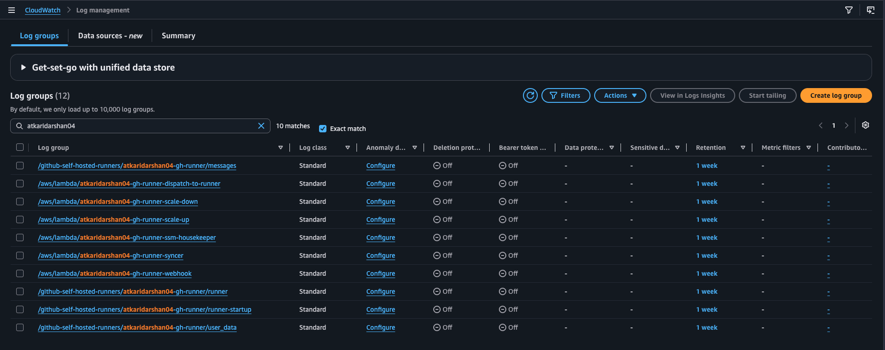

### Open a shell on a runner

`enable_ssm_on_runners = true` gives the runner role the permissions Session Manager needs, so you can get a shell on an instance with no SSH key and no inbound port. Runners are ephemeral, so open the session while a job is running; the instance disappears once the job ends.

**Prerequisites**

- AWS CLI v2 and the [Session Manager plugin](https://docs.aws.amazon.com/systems-manager/latest/userguide/session-manager-working-with-install-plugin.html) (`brew install --cask session-manager-plugin` on macOS).
- An IAM identity allowed to start sessions on the runners (policy below).
- The SSM agent running on the instance. AWS lists Ubuntu Server 22.04 as having it preinstalled. If it doesn't, check the agent on the instance (`snap list amazon-ssm-agent` or `systemctl status amazon-ssm-agent`) and add its install to the Packer template if it's missing.
- Network access from the instance to the SSM service (outbound internet or VPC endpoints).

**Find the instance**

Runner instances are named `<PROJECT_NAME>-gh-runner-action-runner`:

```bash
aws ec2 describe-instances --region <REGION> \
  --filters "Name=tag:Name,Values=<PROJECT_NAME>-gh-runner-action-runner" "Name=instance-state-name,Values=running" \
  --query 'Reservations[].Instances[].[InstanceId,LaunchTime]' --output table

aws ssm describe-instance-information --region <REGION> \
  --query 'InstanceInformationList[].[InstanceId,PingStatus]' --output table
```

**Connect and look around**

```bash
aws ssm start-session --target <INSTANCE_ID> --region <REGION>
```

You land in a shell as `ssm-user`; use `sudo -i` for root. Useful once inside:

```bash
docker ps                                            # containers the job started
ls /opt/actions-runner                               # runner install directory
sudo tail -f /opt/actions-runner/_diag/Runner_*.log  # runner log; look for "Listening for Jobs"
```

Type `exit` to leave. Add `--profile <PROFILE>` to the AWS commands if you use named profiles.

**Who can connect**

The runner role's permissions don't let any person connect; that takes `ssm:StartSession` on their own IAM identity. This policy limits it to the runner instances:

```json
{
  "Version": "2012-10-17",
  "Statement": [
    {
      "Effect": "Allow",
      "Action": "ssm:StartSession",
      "Resource": "arn:aws:ec2:<REGION>:<ACCOUNT_ID>:instance/*",
      "Condition": {
        "StringEquals": { "aws:ResourceTag/Name": "<PROJECT_NAME>-gh-runner-action-runner" }
      }
    },
    {
      "Effect": "Allow",
      "Action": "ssm:StartSession",
      "Resource": "arn:aws:ssm:<REGION>::document/SSM-SessionManagerRunShell"
    },
    {
      "Effect": "Allow",
      "Action": ["ssm:TerminateSession", "ssm:ResumeSession"],
      "Resource": "arn:aws:ssm:*:*:session/${aws:username}-*"
    },
    {
      "Effect": "Allow",
      "Action": ["ec2:DescribeInstances", "ssm:DescribeInstanceInformation"],
      "Resource": "*"
    }
  ]
}
```

## Next

- Rebuilding the AMI, cleanup, cost expectations → [operations](05-operations.md)
- Rolling this out beyond a single account/team → [org rollout notes](03-org-rollout.md)
- One fleet enough, or do you need several? → [runner strategies](04-runner-strategies.md)
